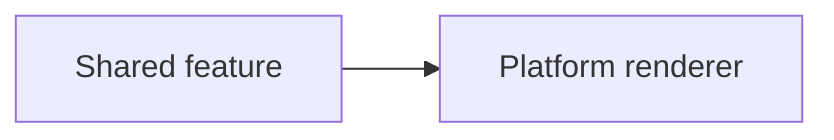

## Summary

- Describe the concrete problem and resulting behavior.

## Architecture

Include this section when changing modules, dependency boundaries, renderer contracts, screen ownership, adaptive recipes or navigation. Otherwise remove it.

### Architecture at a glance

- Give a brief explanation readable on a phone.



## API example

Show a realistic consumer example for public API changes. Otherwise remove this section.

```kotlin
// Replace with the caller-facing API and necessary imports.
```

## Build changes

Include concrete commands/configuration when changing Gradle, modules or CI. Otherwise remove this section.

```sh
# Replace with the relevant build/validation commands.
```

## Visual evidence

For visual changes, embed descriptive, content-addressed PNG URLs from the visual-evidence release assets. Existing scenarios show Main | Pixel difference | PR; new scenarios show an added preview. Reviewed goldens belong in main; generated comparisons belong in release assets. Artifact links alone are insufficient. Remove this section for nonvisual changes.

## Verification

- List the relevant checks and outcomes, including limitations.
