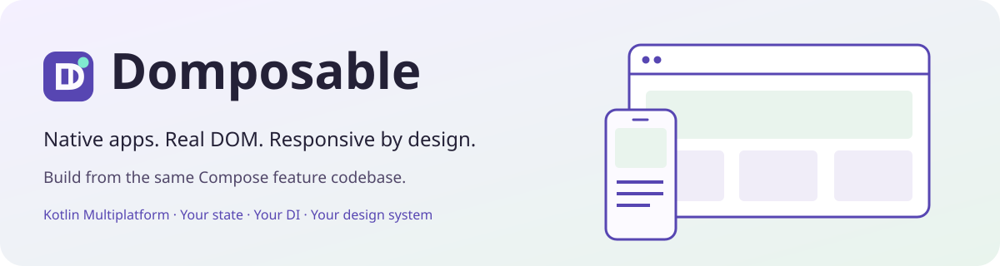
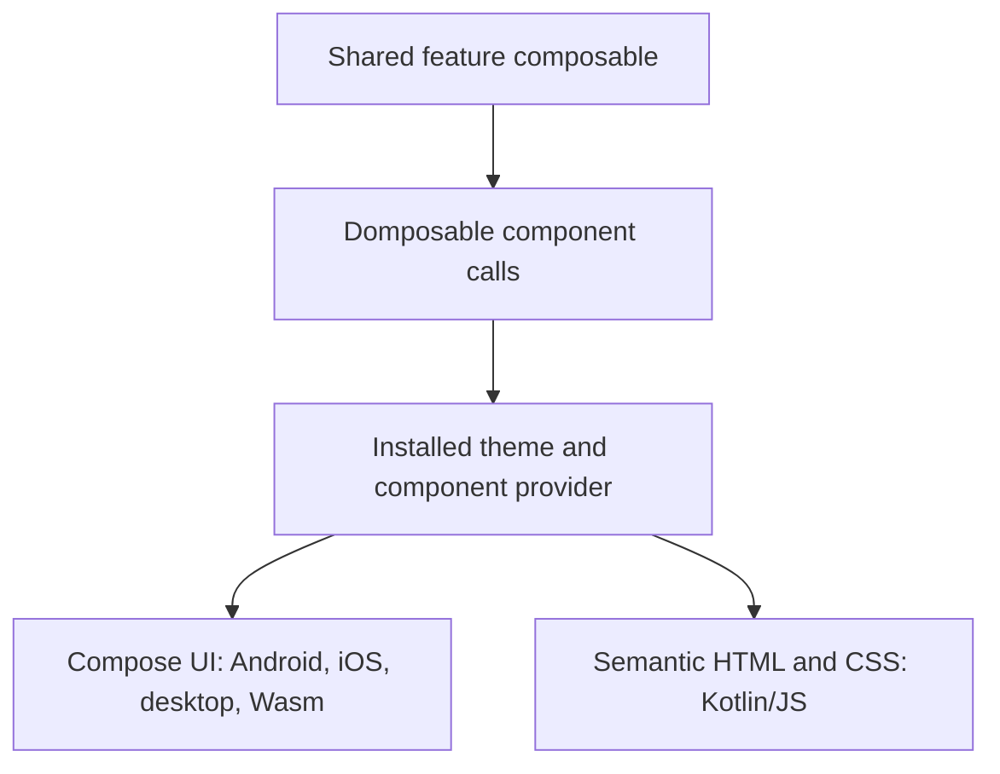
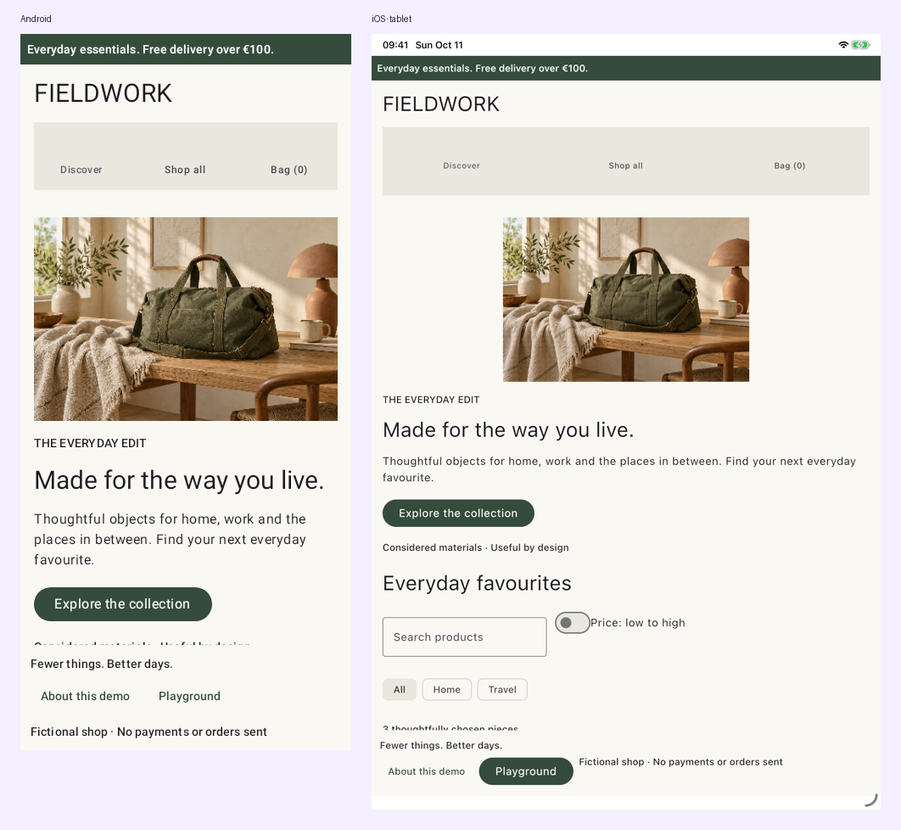

# Domposable

**Native apps and responsive DOM websites from the same Compose feature codebase.**

[](https://github.com/samuolis/domposable/actions/workflows/ci.yml)
[](https://github.com/samuolis/domposable/releases/latest)
[](LICENSE)

[Documentation](https://samuolis.github.io/domposable/) · [Shopping demo](https://samuolis.github.io/domposable/shop/) · [Playground](https://samuolis.github.io/domposable/demo/) · [Compare HTML and Wasm](https://samuolis.github.io/domposable/compare/) · [API reference](https://samuolis.github.io/domposable/api/)

Domposable is a Kotlin Multiplatform library built on Compose. Feature teams write regular composables with shared components, modifiers and adaptive layouts. An installed design system provider renders those calls as Compose UI on native targets or semantic HTML on Kotlin/JS.

## Contents

- [Features](#features)
- [Quick start](#quick-start)
- [How it works](#how-it-works)
- [Supported platforms](#supported-platforms)
- [Examples](#examples)
- [Modules](#modules)
- [Documentation](#documentation)
- [Contributing](#contributing)
- [License](#license)

## Features

- **Shared feature code** — ordinary Compose functions with your models and callbacks.
- **Real HTML** — headings, links, forms and header/main/footer landmarks, styled with CSS.
- **A replaceable design system** — portable theme tokens and typed renderers; customize one control or supply a complete provider.
- **Adaptive layouts** — measure the space a feature receives and choose breakpoints, panes and layout recipes.
- **Shared components** — layout, forms, selection, navigation and feedback controls across both renderers.
- **Optional screen tooling** — manual registration, generated KSP entries, Navigation 3 and browser URL integration when your app needs them.

Your application owns its dependencies and state. Pass an existing ViewModel, use your DI container's Compose integration, or keep state in a composable.

> [!NOTE]
> This README describes `main`. Choose a published version from [Releases](https://github.com/samuolis/domposable/releases). The 0.1.x provider has 34 renderer contracts; the expanded 41-contract provider requires 0.2.0 or later. Before 1.0, minor releases may change APIs.

## Quick start

### 1. Add the library

Add `mavenCentral()` and `google()` to your repositories, then replace `<released-version>` with a version from [Releases](https://github.com/samuolis/domposable/releases).

```kotlin
val domposableVersion = "<released-version>"

kotlin {
    sourceSets {
        commonMain.dependencies {
            implementation("io.github.samuolis.domposable:domposable-design-material:$domposableVersion")
            // Optional: adaptive layout helpers.
            implementation("io.github.samuolis.domposable:domposable-adaptive:$domposableVersion")
        }
    }
}
```

The Material artifact includes the shared UI API and default platform providers. See the [installation guide](docs/getting-started.md) and [tested toolchain](docs/compatibility.md) for Compose plugins and target setup.

### 2. Write a shared feature

```kotlin
import androidx.compose.runtime.Composable
import io.github.samuolis.domposable.foundation.*
import io.github.samuolis.domposable.material.DomposableMaterialTheme
import io.github.samuolis.domposable.ui.*

@Composable
fun ContactsScreen(onAddContact: () -> Unit) {
    DomposableColumn(
        modifier = DomposableModifier.padding(16.dp),
        gap = 12.dp,
    ) {
        DomposableText("Contacts", style = DomposableTextStyle.Title)
        DomposableButton("Add contact", onAddContact)
    }
}

@Composable
fun App(onAddContact: () -> Unit) {
    DomposableMaterialTheme {
        ContactsScreen(onAddContact)
    }
}
```

### 3. Call it from your platform host

Use Android `setContent`, iOS `ComposeUIViewController`, a desktop Compose window, JS `renderComposable` or Wasm `ComposeViewport`. The feature and its callbacks stay in `commonMain`; the host selects the platform's composition environment.

[Platform entry-point examples →](docs/getting-started.md#platform-entry-points)

## How it works

Each `Domposable` component reads the nearest theme's typed renderer and forwards its values, callbacks and ordered modifier chain. The renderer creates the platform control and connects events back to the feature.



The same feature can use different element structures and styling on each platform. Change tokens for colors, typography and spacing, or replace a renderer for a different control implementation. Component use requires no application KSP setup or navigation registry.

[Understand the API →](docs/how-it-works.md) · [Customize a design system →](docs/design-systems.md) · [Build adaptive layouts →](docs/adaptive.md)

## Supported platforms

| Target | Rendering | Support |
| --- | --- | --- |
| Android, API 24+ | Compose UI + Material 3 | Supported |
| iOS arm64 and arm64 simulator | Compose UI + Material 3 | Supported |
| Web, Kotlin/JS | Semantic DOM + CSS + browser controls | Supported |
| JVM desktop | Compose UI + Material 3 | Experimental |
| Web, Kotlin/Wasm | Compose UI in the browser | Experimental |

HTML supports browser history and hash or path URLs. Wasm currently selects its initial screen from the URL and then navigates in memory. HTML collections normally render all keyed items; fixed-height columns can opt into [bounded windowing](https://samuolis.github.io/domposable/performance/).

[Compatibility, tested versions and platform boundaries →](docs/compatibility.md)

## Examples

| Example | What to explore | Open |
| --- | --- | --- |
| **Fieldwork shop** | Responsive storefront, product pages, filters, cart and checkout | [Live app](https://samuolis.github.io/domposable/shop/) · [Walkthrough](docs/shopping.md) |
| **Component playground** | Shared controls, theme tokens and renderer customization | [Live app](https://samuolis.github.io/domposable/demo/) · [Components](docs/components.md) |
| **HTML / Wasm comparison** | The same feature at phone, tablet and desktop widths | [Compare](https://samuolis.github.io/domposable/compare/) |
| **Browser routes** | Clean paths, deep links and browser navigation | [URL example](https://samuolis.github.io/domposable/routes/tasks/welcome/) · [Routing guide](docs/screens.md) |

### One shopping feature, multiple platforms

The fictional Fieldwork shop shares its catalogue, cart and feature composables. On the web it uses real links and form controls, with product URLs such as `/domposable/shop/products/canvas-weekender/`.


<details>
<summary><strong>See the same shop on Android and iOS</strong></summary>



</details>

<details>
<summary><strong>Compare shared controls on mobile and semantic HTML</strong></summary>


</details>

### A modular app for feature teams

The [modular shopping example](docs/modular-demo.md) separates catalog and checkout into **API and implementation modules**. Metro injects entry-owned ViewModels, a composition local supplies typed navigation, and optional KSP generates feature entries. The [screen guide](docs/screens.md) also shows manual registration and direct Navigation 3 integration.

## Modules

Use the pieces your application needs. All artifacts use `io.github.samuolis.domposable:<artifact>:<released-version>`.

### Components and design

| Artifact | Purpose |
| --- | --- |
| `domposable-foundation` | Portable values and theme tokens |
| `domposable-ui` | Shared components, typed renderer contracts and ordered modifiers |
| `domposable-design-material` | Default native Material and semantic HTML providers |
| `domposable-adaptive` | Content-sized breakpoints, preferences and pane recipes |

### Optional screen integration

| Artifact | Purpose |
| --- | --- |
| `domposable-screens` | Typed registration and entry-owned resources/saveables |
| `domposable-navigation3` | Navigation 3 hosts and HTML browser history |
| `domposable-lifecycle-viewmodel` | AndroidX entry ownership and optional state/action helpers |
| `domposable-ksp` | Generated typed entries and feature entry lists |

## Documentation

| I want to… | Read |
| --- | --- |
| Install Domposable and set up platform hosts | [Getting started](docs/getting-started.md) |
| Understand components, props, providers and modifiers | [How the API works](docs/how-it-works.md) |
| Use shared controls with examples | [Components](docs/components.md) |
| Adapt a feature to its available space | [Adaptive layouts](docs/adaptive.md) |
| Build or customize a design system | [Design systems](docs/design-systems.md) |
| Add screens, Navigation 3 or generated entries | [Screens and navigation](docs/screens.md) |
| Integrate Metro or Kobweb | [Integrations](docs/integrations.md) |
| Follow the API/implementation module example | [Modular app walkthrough](docs/modular-demo.md) |
| Check supported versions and limitations | [Compatibility](docs/compatibility.md) |
| Browse generated declarations | [API reference](https://samuolis.github.io/domposable/api/) |

## Contributing

Bug reports and focused contributions are welcome. Start with [CONTRIBUTING.md](CONTRIBUTING.md) for local setup, validation and maintainer workflows, or [open an issue](https://github.com/samuolis/domposable/issues).

PR checks cover ktlint, detekt, Android lint, JVM/Android [coverage floors](docs/coverage.md), packaged consumers, and functional/screenshot tests across native, HTML and Wasm targets. CI keeps reports and captures in GitHub Actions artifacts.

## License

[Apache License 2.0](LICENSE). Copyright 2026 Samuolis.
