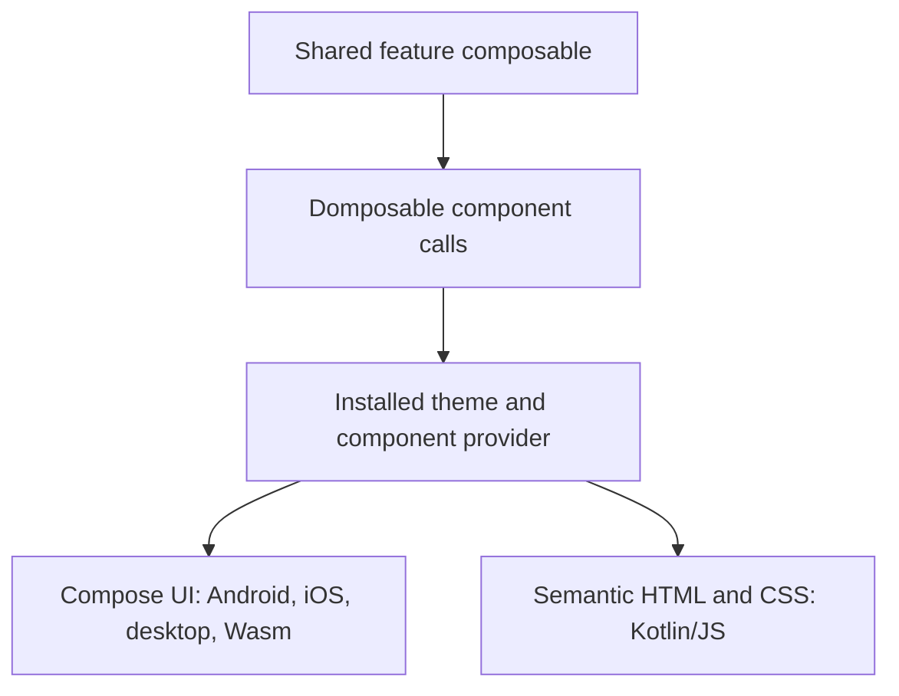
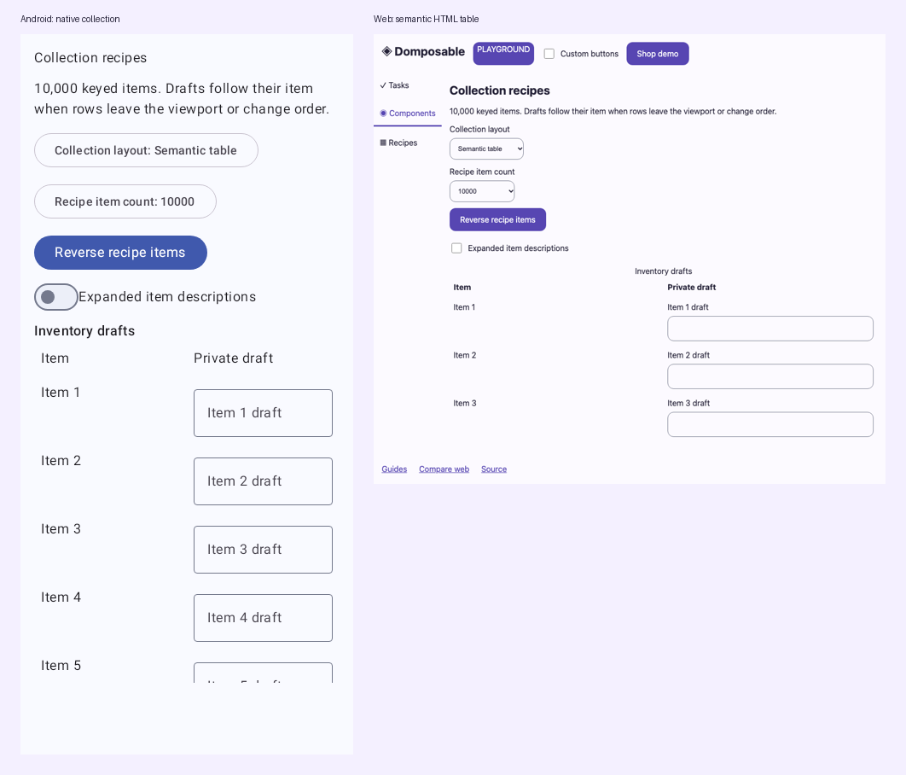
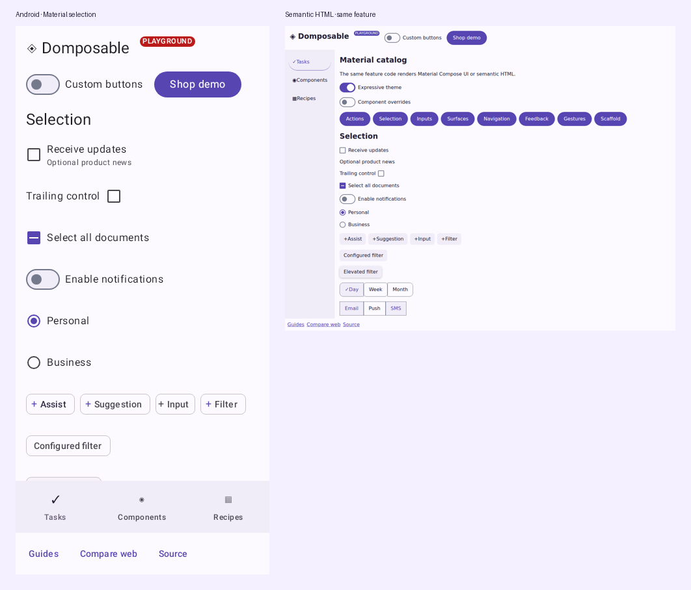

# Domposable

**Share your Compose code across native apps and semantic HTML, with responsive layouts on every platform.**

The 0.9.0 demo shares **90.9% of its application source** across targets. Built-in sizing, wrapping and adaptive pane APIs let the same feature respond to phone, tablet and desktop space. [What the sharing measurement includes](docs/how-it-works.md#code-sharing-and-responsive-layouts).

[](https://github.com/samuolis/domposable/actions/workflows/ci.yml)
[](https://github.com/samuolis/domposable/releases/latest)
[](LICENSE)

[Documentation](https://samuolis.github.io/domposable/) · [Shopping demo](https://samuolis.github.io/domposable/shop/) · [Playground](https://samuolis.github.io/domposable/demo/) · [API reference](https://samuolis.github.io/domposable/api/)

Domposable is a Kotlin Multiplatform UI library with optional integration helpers, built on Compose. Feature teams write regular composables with shared components, modifiers and adaptive layouts. An installed design system provider renders those calls as Compose UI on native targets or semantic HTML on Kotlin/JS. The primary web target is HTML; it does not require Wasm.

> [!IMPORTANT]
> **The HTML target is a client-rendered single-page application (SPA), built on Compose HTML. Domposable does not provide server-side rendering (SSR).** Route URLs and static hosting entry pages do not render feature content on the server. Hosts such as Kobweb may offer their own static pre-rendering; that is a separate integration, not Domposable SSR.

## Contents

- [Features](#features)
- [Quick start](#quick-start)
- [How it works](#how-it-works)
- [Supported platforms](#supported-platforms)
- [Examples](#examples)
- [Modules](#modules)
- [Documentation](#documentation)
- [Contributing](#contributing)
- [License](#license)

## Features

- **Shared feature code** — ordinary Compose functions with your models and callbacks.
- **Real HTML** — headings, links, forms and header/main/footer landmarks, styled with CSS.
- **A replaceable design system** — scoped brand styles and typed renderers; customize one control or supply a complete provider.
- **Adaptive layouts** — measure the space a feature receives and choose breakpoints, panes and layout recipes.
- **Optional Material design system** — standard Material 3 components, selected expressive components and variants, with scoped theme styles. [Catalog and configuration](docs/material-catalog.md).
- **Optional screen tooling** — manual registration, generated KSP entries, Navigation 3 and browser URL integration when your app needs them.

The supported baseline uses stable Compose Multiplatform core; optional design mappings do not force an alpha core upgrade. See [tested versions and upgrade policy](docs/compatibility.md).

Your application owns its dependencies and state. Pass an existing ViewModel, use your DI container's Compose integration, or keep state in a composable. [Koin and Metro](docs/screens.md#one-entry-api-for-koin-and-metro) use the same generated entry API; existing frameworks can [reuse the generator with their own annotations and hosts](docs/screens.md#existing-annotations-and-application-hosts).

Build your own visual language with shared layouts and controls, theme an existing provider, or add custom native/HTML renderers and modifier decorations without changing Domposable. [Custom design systems](docs/design-systems.md#build-your-own-ui) keep feature code common across platforms.

> [!NOTE]
> This README describes `main`. Choose a published version from [Releases](https://github.com/samuolis/domposable/releases). Before 1.0, minor releases may change APIs; see the [migration guide](docs/migration.md) when upgrading.

## Quick start

### 1. Add the library

Add `mavenCentral()` and `google()` to your repositories, then replace `<released-version>` with a version from [Releases](https://github.com/samuolis/domposable/releases).

```kotlin
val domposableVersion = "<released-version>"

kotlin {
    sourceSets {
        commonMain.dependencies {
            implementation("io.github.samuolis.domposable:domposable-design-material:$domposableVersion")
            // Optional: adaptive layout helpers.
            implementation("io.github.samuolis.domposable:domposable-adaptive:$domposableVersion")
        }
    }
}
```

The Material artifact includes the shared UI API and default platform providers. See the [installation guide](docs/getting-started.md) and [tested toolchain](docs/compatibility.md) for Compose plugins and target setup.

### 2. Write a shared feature

```kotlin
import androidx.compose.runtime.Composable
import io.github.samuolis.domposable.foundation.*
import io.github.samuolis.domposable.material.DomposableMaterialTheme
import io.github.samuolis.domposable.ui.*

@Composable
fun ContactsScreen(onAddContact: () -> Unit) {
    DomposableColumn(
        modifier = DomposableModifier.padding(16.dp),
        gap = 12.dp,
    ) {
        DomposableText("Contacts", style = DomposableTextStyle.Title)
        DomposableButton("Add contact", onAddContact)
    }
}

@Composable
fun App(onAddContact: () -> Unit) {
    DomposableMaterialTheme {
        ContactsScreen(onAddContact)
    }
}
```

### 3. Call it from your platform host

Use Android `setContent`, iOS `ComposeUIViewController`, a desktop Compose window or Kotlin/JS `renderComposable` for HTML. The feature and its callbacks stay in `commonMain`; the host selects the platform's composition environment. An optional experimental Wasm host is available for Compose UI comparisons.

[Platform entry-point examples →](docs/getting-started.md#platform-entry-points)

## How it works

Each `Domposable` component reads the nearest theme's typed renderer and forwards its values, callbacks and ordered modifier chain. The renderer creates the platform control and connects events back to the feature.



The same feature can use different element structures and styling on each platform. Set theme colors, typography, shapes and component styles, or replace a renderer for a different control implementation. Component use requires no application KSP setup or navigation registry.

Brand the standard controls once; every argument is optional:

```kotlin
DomposableMaterialTheme(
    colors = brandColors,
    styles = DomposableComponentStyles(
        button = DomposableButtonAppearance(shape = DomposableShape.Circle),
    ),
) {
    FeatureScreen()
}
```

Use `DomposableTheme.styles.button.copy(...)` for a local override. Nested themes inherit their enclosing brand values. Styles are composition-scoped, so different parts of an app can use different brands.

Custom cards are shared composition too: use `DomposableBox` for overlapping image/content layers, a portable gradient for the scrim, and the same theme for controls. Application CSS is an escape hatch for a custom renderer, rather than a requirement for every custom layout. [Build a card without CSS](docs/custom-components.md#image-cards-and-overlays-without-application-css) · [Card and pane demo](https://samuolis.github.io/domposable/demo/#/composition).

[Understand the API →](docs/how-it-works.md) · [Customize a design system →](docs/design-systems.md) · [Build adaptive layouts →](docs/adaptive.md)

### Start where your app is

| Your app | Adopt | Keep in your app |
| --- | --- | --- |
| Starting a shared UI | Material provider, components and adaptive helpers | Models, DI and application behaviour |
| Has a design system | [Theme defaults](docs/design-systems.md#theme-defaults-and-component-overrides) and thin adapters behind existing component names | Brand tokens, product layouts and custom controls |
| Has Navigation 3 or another router | Optional entry display, pane and browser helpers | Back stack, entry decorators, route identity and URL policy |
| Has screen annotations and codegen | Optional KSP function driver | Annotation contract, DI bindings and generated host templates |

Components and adaptive helpers do not depend on the screen registry, navigator or ViewModel adapter. KSP is optional. Your app can use Koin, Metro, another DI container or no DI.

Existing Compose UI widgets cannot run inside an HTML composition. Sharing a feature requires portable component calls or your own native/HTML adapters; this is more than changing imports. [Migrate one feature at a time →](docs/migration.md)

## Supported platforms

| Target | Rendering | Support |
| --- | --- | --- |
| Android, API 24+ | Compose UI + Material 3 | Supported |
| iOS arm64 and arm64 simulator | Compose UI + Material 3 | Supported |
| Web, Kotlin/JS | Semantic DOM + CSS + browser controls | Supported |
| JVM desktop | Compose UI + Material 3 | Experimental |
| Web, Kotlin/Wasm | Compose UI in the browser | Experimental |

HTML and Wasm support optional browser history, hash or path URLs and portable entry-state restoration. HTML collections normally render all keyed items; columns, rows, grids and tables can opt into [bounded windowing](https://samuolis.github.io/domposable/performance/).

[Compatibility, tested versions and platform boundaries →](docs/compatibility.md)

## Examples

- [Custom components and modifiers](docs/custom-components.md): shared component APIs, app-owned CSS/HTML decoration and native `drawBehind`. Web adapters can also [attach CSS and attributes directly](docs/modifiers.md#set-html-attributes-in-jsmain).
- [Component parameter reference](docs/component-reference.md) and [modifier signatures](docs/modifier-reference.md): generated from the current API.

| Example | What to explore | Open |
| --- | --- | --- |
| **Fieldwork shop** | Responsive storefront, product pages, filters, cart and checkout | [Live app](https://samuolis.github.io/domposable/shop/) · [Walkthrough](docs/shopping.md) |
| **Documents and data** | Rich inputs, typed choices, forms, disclosure, rich text, charts and interactive tables | [Shared source](demo/src/commonMain/kotlin/io/github/samuolis/domposable/demo/ProductComponentLab.kt) · [Recipes](docs/components.md#documents-rich-inputs-and-data) |
| **Material and expressive catalog** | Theme defaults, local appearance overrides, pickers, menus, expressive actions and screen chrome | [Live catalog](https://samuolis.github.io/domposable/demo/#/material/actions) · [Shared source](demo/src/commonMain/kotlin/io/github/samuolis/domposable/demo/MaterialCatalog.kt) · [API guide](docs/material-catalog.md) |
| **Component playground** | Shared controls, theme tokens and renderer customization | [Live app](https://samuolis.github.io/domposable/demo/) · [Components](docs/components.md) |
| **HTML / Wasm comparison** | The same feature at phone, tablet and desktop widths | [Compare](https://samuolis.github.io/domposable/compare/) |
| **Browser routes** | Clean paths, deep links and browser navigation | [URL example](https://samuolis.github.io/domposable/routes/tasks/welcome/) · [Routing guide](docs/screens.md) |
| **Large collections** | Measured lists, horizontal rows, responsive grids and semantic tables | [Gallery](https://samuolis.github.io/domposable/demo/#/collection-recipes) · [Guide](docs/performance.md) |
| **Navigation policies** | Route overlays, Back previews and live models across root switches | [Recipe](https://samuolis.github.io/domposable/demo/#/navigation-policies) · [Guide](docs/recipes.md) |
| **Saved root stacks** | Independent tabs, restored drafts and caller-owned Navigation 3 scenes | [Recipe source](demo/src/commonMain/kotlin/io/github/samuolis/domposable/demo/RootStackRecipe.kt) · [Guide](docs/recipes.md) |

### Collections with real table semantics



[Explore large collections →](docs/performance.md)

### One shopping feature, multiple platforms

The fictional Fieldwork shop shares its catalogue, cart and feature composables. On the web it uses real links and form controls, with product URLs such as `/domposable/shop/products/canvas-weekender/`.


<details>
<summary><strong>See the same shop on Android and iOS</strong></summary>


</details>

<details>
<summary><strong>Compare shared controls on mobile and semantic HTML</strong></summary>




See the [Material catalog](docs/material-catalog.md) for standard and expressive variants, theme configuration and per-component overrides.


The [extension example](docs/custom-components.md) combines a custom label, native drawing and HTML/CSS decoration while keeping counter and input state in shared code.

</details>

### A modular app for feature teams

The [modular shopping example](docs/modular-demo.md) separates catalog and checkout into **API and implementation modules**. Metro injects entry-owned ViewModels, a composition local supplies typed navigation, and optional KSP generates feature entries. The [screen guide](docs/screens.md) also shows manual registration and direct Navigation 3 integration.

## Modules

Use the pieces your application needs. All artifacts use `io.github.samuolis.domposable:<artifact>:<released-version>`.

### Components and design

| Artifact | Purpose |
| --- | --- |
| `domposable-foundation` | Portable values and theme tokens |
| `domposable-ui` | Shared components, typed renderer contracts and ordered modifiers |
| `domposable-design-material` | Default native Material and semantic HTML providers |
| `domposable-adaptive` | Content-sized breakpoints, preferences and pane recipes |

### Optional screen integration

| Artifact | Purpose |
| --- | --- |
| `domposable-screens` | Typed registration and entry-owned resources/saveables |
| `domposable-navigation3` | Navigation 3 hosts and HTML/Wasm browser history |
| `domposable-lifecycle-viewmodel` | AndroidX entry ownership and optional state/action helpers |
| `domposable-ksp` | Generated typed entries and feature entry lists |

## Documentation

| I want to… | Read |
| --- | --- |
| Install Domposable and set up platform hosts | [Getting started](docs/getting-started.md) |
| Understand components, props, providers and modifiers | [How the API works](docs/how-it-works.md) |
| Use shared controls with examples | [Components](docs/components.md) |
| Configure Material 3 and expressive components | [Material catalog](docs/material-catalog.md) |
| Adapt a feature to its available space | [Adaptive layouts](docs/adaptive.md) |
| Build or customize a design system | [Design systems](docs/design-systems.md) |
| Add screens, Navigation 3 or generated entries | [Screens and navigation](docs/screens.md) |
| Integrate Koin, Metro or Kobweb | [Integrations](docs/integrations.md) |
| Follow the API/implementation module example | [Modular app walkthrough](docs/modular-demo.md) |
| Check supported versions and limitations | [Compatibility](docs/compatibility.md) |
| Compare Wasm input and accessibility | [Shared input lab and tested boundaries](docs/wasm.md) |
| Browse generated declarations | [API reference](https://samuolis.github.io/domposable/api/) |

## Contributing

Bug reports and focused contributions are welcome. Start with [CONTRIBUTING.md](CONTRIBUTING.md) for local setup, validation and maintainer workflows, or [open an issue](https://github.com/samuolis/domposable/issues).

PR checks cover ktlint, detekt, Android lint, JVM/Android [coverage floors](docs/coverage.md), required [binary API checks](docs/binary-compatibility.md), packaged consumers, and functional/screenshot tests across native, HTML and Wasm targets. CI keeps reports and captures in GitHub Actions artifacts. API baseline changes need compatibility, migration and version-impact notes.

## License

[Apache License 2.0](LICENSE). Copyright 2026 Samuolis.
