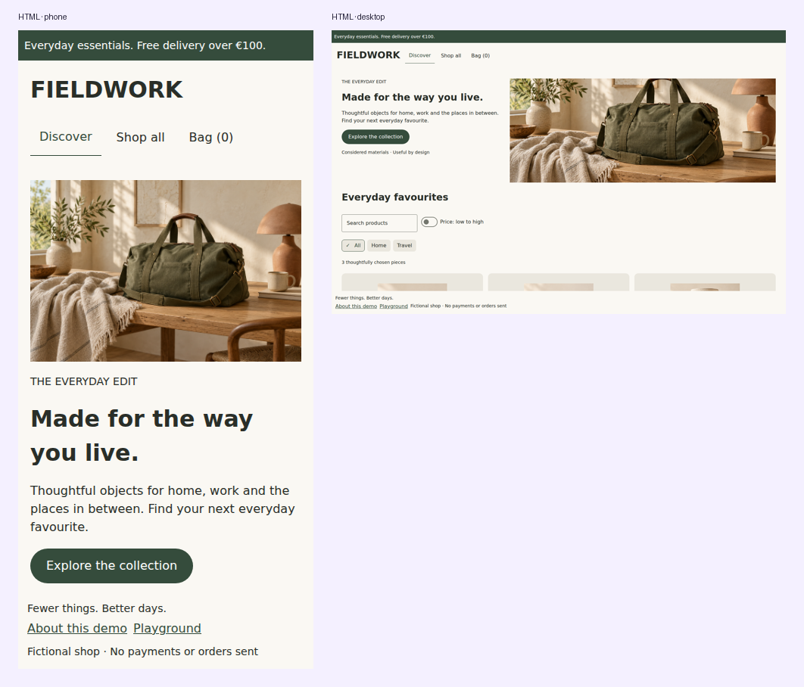

# Adaptive UI

Measure feature content after shell navigation/insets with `DomposableMeasure` or the scaffold's `availableContentSize`. Classify that width with `rememberDomposableAdaptiveInfo`. Feature breakpoints remain independent from the full window.

Defaults: Compact below 600, Medium from 600, Expanded from 840, Large from 1200 logical units. Override `DomposableBreakpoints` for your product. `DomposableResponsive` inherits smaller-class values unless explicitly overridden.

```kotlin
DomposableMeasure { size ->
    val info = rememberDomposableAdaptiveInfo(size)
    val recipe = DomposablePaneRecipe()
    FeaturePanes(dualPane = recipe.isDualPane(info))
}
```

Recipes change presentation, not route identity or model ownership. The demo keeps list/detail entries when changing between a bottom navigation shell and a rail, or one/two feature panes.

## Shared list/detail relationships

`DomposablePane` describes relationships between your own routes. `resolveDomposablePaneLayout`
selects a related list/detail pair at wide sizes and the active entry at compact sizes. An unrelated
task stays single-pane. The result retains the original entry objects and never changes the stack.

```kotlin
fun pane(route: Route): DomposablePane<Route>? = when (route) {
    Route.Catalog -> DomposablePane.List("catalog")
    is Route.Product -> DomposablePane.Detail("catalog", Route.Catalog)
    else -> null
}

val layout = resolveDomposablePaneLayout(entries, wide) { pane(it.route) }
when (layout) {
    is DomposablePaneLayout.Single -> RenderEntry(layout.entry)
    is DomposablePaneLayout.ListDetail -> BrandedPanes(layout.list, layout.detail)
}
```

For a direct link, `ensureDomposablePaneParent(entries, entryRoute, ::pane, createEntry)` returns
a stack containing the declared list parent once, retaining the detail's identity. The application
decides when to apply it. `domposablePaneShouldReplaceDetail` and
`domposablePaneShouldReplaceSiblingDetail` provide selection policy without performing navigation.
The latter uses an optional stable `siblingKey` for tabs belonging to the same selected item.

Renderers can provide `LocalDomposablePaneRole` with `List`, `Detail` or `Supporting` while
composing a paired layout; its default is `null` for standalone presentation. Pane proportions,
chrome and transitions remain configurable in the product renderer. The same relationship helpers
work with native Nav3 scenes and semantic HTML without requiring KSP, a registry or a navigator.

## Render the panes with shared composables

`DomposablePaneScaffold` renders the selected layout without app-owned HTML, CSS or native layout
code. It accepts your existing entry objects and never changes their ownership or navigation state.

```kotlin
DomposablePaneScaffold(
    layout = resolveDomposablePaneLayout(entries, wide) { pane(it.route) },
    listLabel = "Catalog",
    detailLabel = "Product details",
    listFraction = 0.32f,
    minListWidth = 260.dp,
    maxListWidth = 360.dp,
    retainedList = entries.firstOrNull { pane(it.route) is DomposablePane.List },
    singlePaneRole = if (pane(entries.last().route) is DomposablePane.List)
        DomposablePaneRole.List else DomposablePaneRole.Detail,
    contentKey = { it.id },
) { entry ->
    RenderEntry(entry)
}
```

The list fraction is computed from the full available pane width and then clamped to its bounds.
Configure spacing, logical edge borders and other brand details with `listModifier` and
`detailModifier`. Both panes receive labelled region semantics. `LocalDomposablePaneRole` is set
only in the paired presentation so a standalone screen keeps its normal chrome. Native expanded
panes fill a bounded parent height, so place the scaffold in a viewport-sized container; HTML panes
stretch to the taller pane's natural content height.

When `retainedList` is supplied, a compact detail hides that list without removing its composition.
Its remembered drafts survive the resize. Hidden content occupies no layout space and is absent
from keyboard navigation and accessibility. `DomposableVisibility` exposes the same behavior for
other application-owned adaptive compositions.

HTML pane sizing updates the same host element across breakpoints, preserving descendant DOM
identity and scroll offsets when a retained pane is shown again. For custom pane modifiers, vary
operation values instead of adding or removing operations when browser focus or scroll must survive.
For example, keep the padding operation in both layouts:

```kotlin
listModifier = DomposableModifier.padding(
    DomposableInsets(end = if (wide) 20.dp else 0.dp),
)
```

HTML modifier operations can create ordered wrapper elements. Adding or removing those operations
can replace descendants; a stable `contentKey` preserves entry identity but does not make an arbitrary
modifier wrapper change preserve browser state.

Reduced motion follows browser media queries, Android animator duration settings and iOS accessibility notifications. Pointer precision follows browser media queries and Android connected mouse/touchpad devices. iOS defaults to touch and desktop to precise; applications may override either preference through the adaptive API when they have more precise input information. Preference information is advisory; providers/features choose animations and targets.

## Responsive dimensions and wrapping

```kotlin
DomposableMeasure(DomposableModifier.fillMaxWidth()) { size ->
    if (size.width <= 0f) return@DomposableMeasure
    val info = rememberDomposableAdaptiveInfo(size)
    val spacing = DomposableResponsive(12.dp, medium = 16.dp, expanded = 24.dp)
        .resolve(info.widthClass)
    DomposableFlowRow(gap = spacing) {
        DomposableButton("Save", onSave)
        DomposableButton("Share", onShare)
    }
}
```

Measurement initially reports zero until the platform lays out the feature. Wait for a positive size before starting requests that depend on dimensions, such as image decoding or pagination. The storefront does this before choosing hero/card widths.

## A feature-specific pane recipe

```kotlin
DomposableScaffold(topBar = { AppHeader() }) {
    val info = rememberDomposableAdaptiveInfo(availableContentSize)
    val recipe = DomposablePaneRecipe(dualPaneFrom = DomposableWidthClass.Expanded)
    DomposableNavigation3Host(
        stack, registry,
        modifier = contentModifier.fillMaxWidth().fillMaxHeight(),
        visibleEntries = if (recipe.isDualPane(info)) 2 else 1,
    ) { if (stack.size > 1) stack.removeLast() }
}
```

Keep stack/model ownership outside the layout decision. Shrinking from two panes to one hides an entry without popping it. The [navigation recipes](recipes.md) demonstrate drafts surviving width changes and a supporting third pane.


