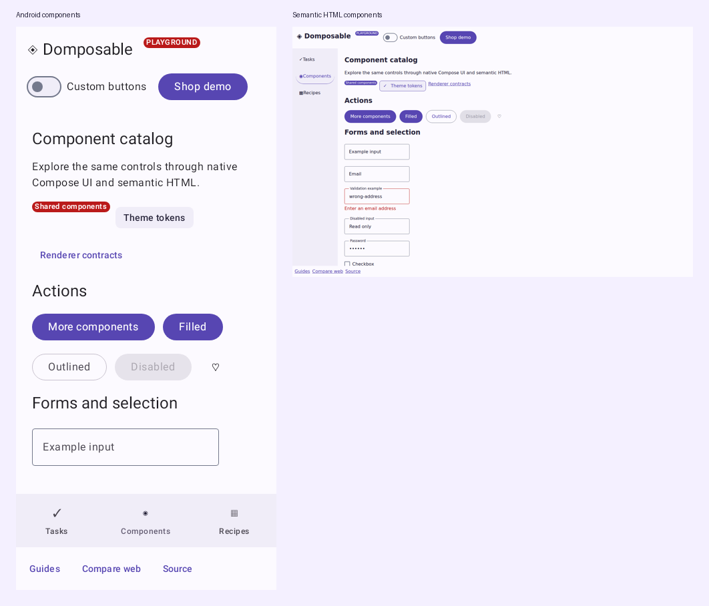
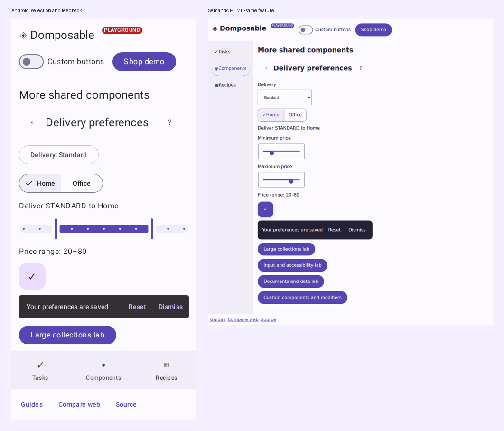

# Shared components

Use direct composable calls in shared feature code and install a provider at the app root. The shared API has typed renderer contracts with Compose UI and semantic HTML implementations; Wasm uses the Compose UI provider. [How the API works](how-it-works.md) explains the call path and [the catalog](https://samuolis.github.io/domposable/demo/#/catalog) exercises the controls.

The [Material 3 and expressive catalog](material-catalog.md) maps component families to their shared APIs and shows theme, appearance and screen-scaffold configuration.



## Forms and selection

```kotlin
@Composable
fun NewsletterForm(onSubscribe: (String) -> Unit) {
    var email by remember { mutableStateOf("") }
    var consent by remember { mutableStateOf(false) }
    DomposableColumn(DomposableModifier.padding(16.dp), gap = 12.dp) {
        DomposableText("Stay in the loop", style = DomposableTextStyle.Title)
        DomposableTextField(email, { email = it }, "Email address", purpose = DomposableInputPurpose.Email)
        DomposableCheckbox(consent, { consent = it }, "Send me occasional news")
        DomposableButton("Subscribe", { onSubscribe(email) }, enabled = consent && email.isNotBlank())
    }
}
```

The app owns validation and submission. Pass an `error` message to TextField or Select to display it and associate it with the control. HTML uses labelled browser inputs; native uses Material controls.

```kotlin
DomposableSelect(
    value = delivery,
    onValueChange = { delivery = it },
    label = "Delivery",
    options = listOf(
        DomposableSelectOption("standard", "Standard"),
        DomposableSelectOption("express", "Express"),
        DomposableSelectOption("same-day", "Same day", enabled = false),
    ),
)
DomposableSegmentedButtons(
    labels = listOf("Home", "Office"),
    selectedIndex = addressIndex,
    onSelect = { addressIndex = it },
    label = "Delivery address",
)
DomposableRangeSlider(
    value = priceRange,
    onValueChange = { priceRange = it },
    startLabel = "Minimum price",
    endLabel = "Maximum price",
    range = 0f..100f,
    steps = 9,
)
```

Select values must be unique and include the current value. Use an explicit placeholder option when no choice has been made. Native presents a Material dropdown; HTML emits a `<select>` with disabled options and preserves the app's controlled value. SegmentedButtons provides one selected choice with native selection semantics or an HTML radio group. A range has ordered, finite endpoints inside its bounds; `steps = 9` divides 0–100 into ten intervals. HTML displays two labelled browser sliders; native uses Material's two-thumb slider. Both thumbs remain independently accessible.



Both previews run `ExtendedComponentCatalog()` from `commonMain`. The provider changes the controls' structure; the selected delivery, address, price range and callbacks come from the same feature. The [HTML/Wasm comparison](compare.md) lets you change the actual viewport width.

## Actions and help

```kotlin
DomposableButton("Apply", onApply, style = DomposableButtonStyle.Outlined)
DomposableChip("Favorites", onToggleFavorites, selected = favoritesOnly)
DomposableIconButton(onFavorite, label = "Favorite") { DomposableIcon("♡", description = null) }
DomposableTooltip("Saves this item to your favorites") {
    DomposableIconButton(onFavorite, label = "Favorite") { DomposableIcon("♡", description = null) }
}
DomposableLink("Help", "https://example.com/help")
```

Tooltips provide supplemental descriptions. The control still needs its own accessible label. HTML shows help on hover or keyboard focus and supports Escape; native delegates hover/long-press behavior to Material. Link emits a browser anchor or opens the native URI handler. Navigation items with `href` preserve browser new-tab behavior while ordinary clicks call `onSelect`.

Use `description = null` for a decorative Icon inside a labelled control. IconButton and FloatingActionButton take the control's accessible `label`; the decorative glyph does not become part of that name.

## Content and collections

```kotlin
DomposableCard(onClick = onOpenProduct) {
    DomposableColumn(gap = 8.dp) {
        DomposableImage(product.imageUrl, description = product.name)
        DomposableText(product.name, style = DomposableTextStyle.Title)
        DomposableBadge("New")
    }
}
DomposableLazyGrid(
    items = products,
    key = { it.id },
    modifier = DomposableModifier.fillMaxWidth().height(480.dp),
    columns = columnsForContentWidth,
    gap = 16.dp,
) { product -> ProductCard(product) }
```

`ProductCard` belongs to the feature. Keys must be stable and unique. Compose UI collections virtualize; HTML normally emits all keyed items as lists/CSS grid. For large datasets, use optional [column, row, grid and table windows](performance.md). Keep a bounded height when nesting a native lazy collection inside another scroll container. The storefront uses wrapping rows for its small catalogue.

## Shell and feedback

```kotlin
DomposableScaffold(
    topBar = {
        DomposableTopAppBar("My shop", actions = {
            DomposableIconButton(onOpenBag, "Open bag") { DomposableIcon("▣", null) }
        })
    },
    bottomBar = { DomposableLink("Help", "https://example.com/help") },
    floatingAction = {
        DomposableFloatingActionButton(onAdd, "Add item") { DomposableIcon("+", null) }
    },
    snackbar = {
        notice?.let { message ->
            DomposableSnackbar(message, actionLabel = "Undo", onAction = onUndo, onDismiss = onDismissNotice)
        }
    },
) {
    ProductsScreen(model)
}
```

Scaffold owns the full-window shell with header/main/footer landmarks on HTML. Use `DomposableScreenScaffold` for screen chrome inside an application shell. The direct `DomposableSnackbar` call is controlled by the app, as shown above. For serialized requests, timeouts and action results, use the optional [`DomposableSnackbarHostState` and `DomposableSnackbarHost`](material-catalog.md#queued-messages-and-badges). Supply both `actionLabel` and `onAction` when offering a direct snackbar action. Use Banner for inline status and Progress for determinate or indeterminate work.

```kotlin
if (confirming) {
    DomposableDialog(
        title = "Remove item?",
        onDismiss = { confirming = false },
        actions = {
            DomposableButton("Remove", { confirming = false; onRemove() })
        },
    ) {
        DomposableText("This removes the item from your list.")
    }
}
```

The feature owns dismissal and application effects. HTML uses a modal dialog with focus restoration; native uses Material's dialog. BottomSheet follows the same controlled presentation pattern.

## Complete vocabulary

| Family | Components |
| --- | --- |
| Theme | Theme |
| Layout | Column, Row, FlowRow, Box, LazyColumn, LazyRow, LazyGrid, Spacer, Divider, Scaffold |
| Data | Table, DataTable with row/cell actions, LineChart, ValueChart |
| Actions | Button, IconButton, FloatingActionButton, Link, Chip, Tooltip |
| Forms | Form, TextField, Checkbox, Switch, RadioButton, Slider, RangeSlider, Select, SegmentedButtons |
| Content | Text, RichHtml, Disclosure, Image, Icon, Card, Surface, Avatar, Badge |
| Feedback | Banner, Progress, Snackbar, Menu, Dialog, BottomSheet |
| Navigation | TopAppBar, Tabs, NavigationBar |

Every component has direct arguments and a `Props` overload. Keep props for renderer customization or reusable configuration; ordinary feature code can use the calls above. See [design-system customization](design-systems.md), [adaptive examples](adaptive.md) and [platform boundaries](coverage.md).

The additional controls demos share the same source for native, HTML and Wasm. Published 0.3.0 has
42 renderer contracts; the 0.4 API adds Form, Disclosure, RichHtml, LineChart, ValueChart
and DataTable. Check [release versions](https://github.com/samuolis/domposable/releases) before
selecting Maven dependencies.

## Documents, rich inputs and data

[ProductComponentLab](https://github.com/samuolis/domposable/blob/main/demo/src/commonMain/kotlin/io/github/samuolis/domposable/demo/ProductComponentLab.kt)
is a complete shared feature. Run `/demo/#/product-components` in HTML or
`/wasm/#/product-components` after building this branch.

```kotlin
DomposableForm(onSubmit = onSave, label = "Delivery preferences") {
    DomposableTextField(
        email, onEmailChange, "Contact email",
        purpose = DomposableInputPurpose.Email,
        placeholder = "you@example.com",
        helperText = "We only use this for delivery updates",
        imeAction = DomposableImeAction.Done,
    )
    val submit = rememberDomposableFormSubmit()
    DomposableButton("Save", submit)
}
DomposableSegmentedButtons(
    options = listOf(
        DomposableChoiceOption("standard", "Standard"),
        DomposableChoiceOption("express", "Express"),
        DomposableChoiceOption("same-day", "Same day", enabled = false),
    ),
    selectedValue = delivery,
    onSelectionChange = onDeliveryChange,
    label = "Delivery speed",
)
DomposableDisclosure("Shipping details", expanded, onToggle) {
    DomposableRichHtml(descriptionHtml, selectable = true, onLinkClick = onOpenLink)
}
```

Form emits a real browser form and supports native Done/Go/Search/Send actions. The submit helper
always calls the current callback and respects the enclosing form's enabled state. Keep browser
validation enabled for HTML constraint validation; the application still owns domain validation.
TextField adds readonly, password visibility, autocomplete, line limits, helper/error text,
autofocus, explicit IME actions and leading/prefix/trailing slots. HTML multiline fields retain
the browser's two-row initial size by default; `minLines` and `maxLines` bound that initial size
and the maximum control height. Set both to `1` when a one-row textarea is needed. Typed segmented choices keep
selection attached to values when options are reordered or labels are translated.

RichHtml parses a fixed markup allowlist on every target. It removes active content and unsafe link
schemes rather than inserting raw HTML. Native renders annotated text; HTML creates semantic nodes.
Use an application renderer when you need an editor or a full document engine.

```kotlin
val orders = listOf(DomposableChartSeries(
    key = "orders", label = "Orders",
    values = listOf(DomposableChartValue("Mon", 12f), DomposableChartValue("Tue", 18f)),
))
DomposableLineChart(orders, title = "Orders this week", onSelectedIndexChange = onPointSelected)
DomposableValueChart("Order totals", "Sample data", "Daily values", orders, { it.toInt().toString() })
DomposableDataTable(
    columns = listOf(DomposableDataTableColumn("order", "Order")),
    rows = listOf(DomposableDataTableRow("A-101")),
    rowHeaderColumnKey = "order",
    onRowActivate = onOpenOrder,
) { row, _ -> DomposableText(row.key) }
```

Chart series and table rows use unique stable keys. Explicit chart axis indexes represent sparse
data; a series uses either all explicit or all implicit indexes. The caller supplies localized
labels and formatters. HTML draws the line chart as SVG and the data table as a semantic table;
native draws the chart with Canvas and supplies collection semantics. Pointer, touch and keyboard
selection call the same feature callbacks. Cell actions take precedence over row activation.
