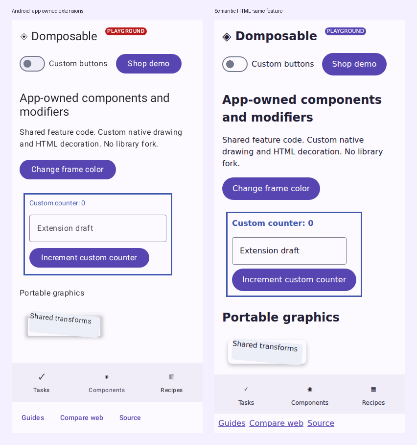

# Build app-owned components

Your application can introduce components without changing Domposable, adopting KSP, or using a particular navigation, DI or state architecture. Keep the feature-facing Compose contract in shared code.

[Live example](https://samuolis.github.io/domposable/demo/#/extensions) · [Supported component parameters](component-reference.md) · [Custom modifiers and drawing](modifiers.md)



## Compose existing shared primitives

For a reusable component made from existing controls, write a normal composable:

```kotlin
@Composable
fun CounterCard(
    count: Int,
    onIncrement: () -> Unit,
    modifier: DomposableModifier = DomposableModifier,
) {
    DomposableCard(modifier) {
        DomposableColumn(DomposableModifier.padding(16.dp), gap = 8.dp) {
            DomposableText("Items: $count")
            DomposableButton("Add item", onIncrement)
        }
    }
}
```

No registration or platform implementation is needed. The installed provider renders the constituent controls. The app owns its public parameters and state; add the slots, callbacks and appearance values your component needs.

## Image cards and overlays without application CSS

A product-specific card does not need a product-specific HTML renderer. Compose its image,
scrim and content with shared primitives in `commonMain`. `DomposableBox` overlays its children
on every renderer; `boxAlignment` places an individual layer within it.

```kotlin
@Composable
fun EventHero(image: String, title: String) {
    val scrim = DomposableLinearGradient(
        axis = DomposableLayoutAxis.Vertical,
        stops = listOf(
            DomposableGradientStop(DomposableColor(0x00000000), 0f),
            DomposableGradientStop(DomposableColor(0xDD000000), 1f),
        ),
    )
    DomposableCard {
        DomposableBox(DomposableModifier.fillMaxWidth().height(240.dp)) {
            DomposableImage(image, null, DomposableModifier.fillMaxSize(),
                scale = DomposableImageScale.Crop)
            DomposableBox(DomposableModifier.fillMaxSize().background(scrim)) {}
            DomposableText(
                title,
                modifier = DomposableModifier
                    .boxAlignment(DomposableAlignment.Start, DomposableAlignment.End)
                    .padding(20.dp),
                appearance = DomposableTextAppearance(color = DomposableColor(0xFFFFFFFF)),
            )
        }
    }
}
```

The theme supplies card appearance, typography and shapes. Use modifier parameters for layout
and explicit style overrides only for the parts that differ from those defaults. Domain data,
navigation callbacks and the card's content remain application code. CSS and native drawing
stay inside Domposable's renderers.

[Run the shared card and pane example](https://samuolis.github.io/domposable/demo/#/composition)
or read its [single common Kotlin implementation](https://github.com/samuolis/domposable/blob/main/demo/src/commonMain/kotlin/io/github/samuolis/domposable/demo/SharedComposition.kt).

## Own the platform markup or drawing

Use this escape hatch for an external widget or behavior that the shared primitives cannot express.
Ordinary cards, dashboards, forms and adaptive layouts should compose shared primitives first.
For a genuinely platform-specific integration, the compiled example declares:

```kotlin
@Composable
expect fun AppCounterLabel(count: Int)
```

Its native implementation uses a native Compose primitive:

```kotlin
@Composable
actual fun AppCounterLabel(count: Int) {
    BasicText("Custom counter: $count")
}
```

Its HTML implementation owns the markup and CSS:

```kotlin
@Composable
actual fun AppCounterLabel(count: Int) {
    Span(attrs = {
        classes("app-counter-label")
        style { property("font-weight", "600") }
    }) {
        Text("Custom counter: $count")
    }
}
```

Feature code calls `AppCounterLabel(count)` in either renderer. Include a shared `DomposableModifier` parameter when callers need layout or semantics customization; consume it with `toComposeModifier()` on native or `DomposableHtmlModifiers` and `domposableAttributes` on HTML. Platform-only widgets, CSS types and native drawing APIs stay in these implementations.

The full [native](https://github.com/samuolis/domposable/blob/main/demo/src/composeUiMain/kotlin/io/github/samuolis/domposable/demo/ExtensionExample.compose.kt) and [HTML](https://github.com/samuolis/domposable/blob/main/demo/src/jsMain/kotlin/io/github/samuolis/domposable/demo/ExtensionExample.dom.kt) files include imports and identifiers. Their stateful caller lives in [commonMain](https://github.com/samuolis/domposable/blob/main/demo/src/commonMain/kotlin/io/github/samuolis/domposable/demo/ExtensionExample.kt). The example's native `drawBehind` and HTML decoration also demonstrate app-owned [modifier extensions](modifiers.md).

### Prefer a side for an HTML menu

When an app-owned DOM trigger has a known placement preference, add the JS-only menu hint alongside its anchor resolver. The menu prefers that side when it has enough room and falls back to its normal viewport-aware placement when it does not:

```kotlin
val menuModifier =
    DomposableModifier
        .htmlMenuAnchor { menuRoot ->
            menuRoot.parentElement?.querySelector("[data-menu-trigger]") as? HTMLElement
        }
        .htmlMenuPlacement(DomposableHtmlMenuPlacement.Above)

DomposableMenu(
    expanded = expanded,
    onDismiss = onDismiss,
    items = actions,
    modifier = menuModifier,
)
```

Use `DomposableHtmlMenuPlacement.Auto` to retain automatic placement, or pass a resolver when the preference depends on the rendered menu's ancestry. This API exists only in the JS source set; native menu placement remains unchanged.

## Replace an existing library renderer

If every `DomposableButton` should use your design system, copy the default provider and replace its button slot. If your application does not use Material, supply a complete provider instead; the core UI module does not require the Material artifact.

```kotlin
val defaults = rememberDomposableMaterialComponents()
val branded = remember(defaults) {
    defaults.copy(button = { props, modifier, content ->
        AppButtonRenderer(props, modifier, content)
    })
}
DomposableTheme(components = branded) {
    FeatureContent()
}
```

`AppButtonRenderer` belongs to the app and has a native or HTML implementation. It receives the library's typed parameters, modifier and content, including enabled state and callbacks. Honor the contract's accessible names, loading state and interaction semantics. Use [theme styles](design-systems.md#theme-defaults-and-component-overrides) when appearance settings are sufficient; replace a renderer when structure or behavior differs.

## Add typed provider bindings when useful

A plain composable or `expect`/`actual` contract is usually enough for an app-owned component. Use the [typed component provider](design-systems.md#add-typed-product-components) when implementations need to be injected, replaced by a nested provider or selected at runtime. Optional KSP generates renderer contracts from annotated props; manual typed keys support generic or handwritten contracts.

Custom renderers must preserve modifier order, controlled state, callbacks, accessibility, focus and resource cleanup. An app-owned component does not need a matching contribution to the library before it can ship.
