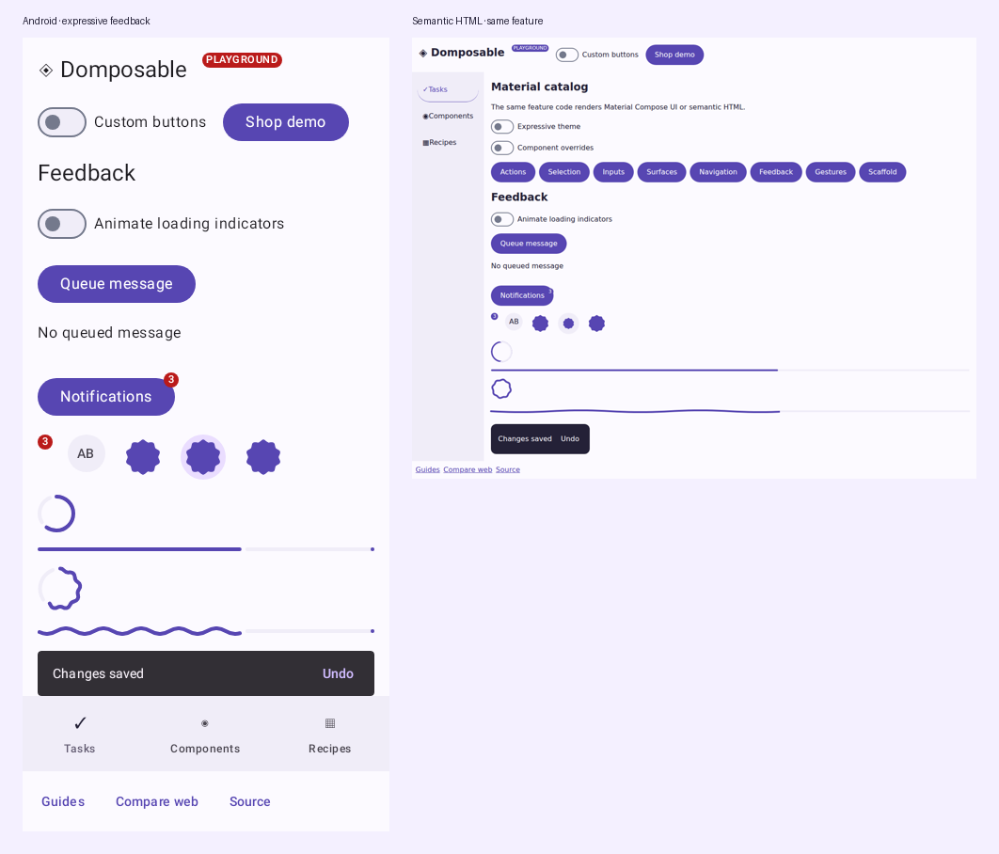

# Material 3 and expressive catalog

Domposable targets Material 3 component families through shared Compose calls. Native targets use Compose Multiplatform Material 3. Kotlin/JS renders semantic HTML. The standard and expressive themes share the same feature API.

The inventory below maps the pinned `org.jetbrains.compose.material3:material3:1.13.0-alpha02` source artifact to shared Domposable components. See [platform coverage](coverage.md) for renderer boundaries and [compatibility](compatibility.md) for tested versions.

Layout helpers, forms, disclosures, rich text, tables and charts are additional Domposable APIs. They are not upstream Material components. Android-specific system integrations and internal Material implementation utilities are outside the component catalog.




| Family | Shared API | Material variants in scope |
| --- | --- | --- |
| Actions | `DomposableButton` | `Button`, `ElevatedButton`, `FilledTonalButton`, `OutlinedButton`, `TextButton` |
| Actions | `DomposableIconButton` | `IconButton`, `FilledIconButton`, `FilledTonalIconButton`, `OutlinedIconButton`, `IconToggleButton`, `FilledIconToggleButton`, `FilledTonalIconToggleButton`, `OutlinedIconToggleButton` |
| Expressive actions | `DomposableToggleButton` | `ToggleButton`, `ElevatedToggleButton`, `FilledTonalToggleButton`, `OutlinedToggleButton` |
| Expressive actions | `DomposableButtonGroup` | `ButtonGroup` |
| Expressive actions | `DomposableSplitButton` | `SplitButtonLayout` |
| Actions | `DomposableFloatingActionButton` | `FloatingActionButton`, `SmallFloatingActionButton`, `MediumFloatingActionButton`, `LargeFloatingActionButton`, `ExtendedFloatingActionButton`, `SmallExtendedFloatingActionButton`, `MediumExtendedFloatingActionButton`, `LargeExtendedFloatingActionButton` |
| Expressive actions | `DomposableFloatingActionButtonMenu` | `FloatingActionButtonMenu`, `FloatingActionButtonMenuItem`, `ToggleFloatingActionButton` |
| Expressive actions | `DomposableFloatingToolbar` | `HorizontalFloatingToolbar`, `VerticalFloatingToolbar` |
| Selection | `DomposableChip` | `AssistChip`, `ElevatedAssistChip`, `SuggestionChip`, `ElevatedSuggestionChip`, `InputChip`, `FilterChip`, `ElevatedFilterChip` |
| Selection | `DomposableCheckbox` | `Checkbox`, `TriStateCheckbox` |
| Selection | `DomposableSwitch` | `Switch` |
| Selection | `DomposableRadioButton` | `RadioButton` |
| Selection | `DomposableSlider` | `Slider`, `VerticalSlider` |
| Selection | `DomposableRangeSlider` | `RangeSlider` |
| Selection | `DomposableSegmentedButtons` | `SingleChoiceSegmentedButtonRow`, `SegmentedButton` |
| Input | `DomposableTextField` | `TextField`, `OutlinedTextField`, `SecureTextField`, `OutlinedSecureTextField` |
| Input | `DomposableSearchBar` | `SearchBar`, `DockedSearchBar`, `ExpandedFullScreenSearchBar`, `ExpandedDockedSearchBar`, `AppBarWithSearch`, `TopSearchBar`, `ExpandedFullScreenContainedSearchBar`, `ExpandedDockedSearchBarWithGap` |
| Input | `DomposableAutocomplete` | `ExposedDropdownMenuBox`, `ExposedDropdownMenu` |
| Input | `DomposableDatePicker` | `DatePicker`, `DatePickerDialog` |
| Input | `DomposableDateRangePicker` | `DateRangePicker` |
| Input | `DomposableTimePicker` | `TimePicker`, `TimeInput`, `TimePickerDialog`, `TimeScroll`, `VibrantTimePickerDialog` |
| Containment | `DomposableCard` | `Card`, `ElevatedCard`, `OutlinedCard` |
| Containment | `DomposableSurface` | `Surface` |
| Containment | `DomposableListItem` | `ListItem`, `SegmentedListItem` |
| Containment | `DomposableCarousel` | `HorizontalMultiBrowseCarousel`, `HorizontalUncontainedCarousel`, `HorizontalCenteredHeroCarousel` |
| Communication | `DomposableBadge` / `DomposableBadgedBox` | `Badge`, `BadgedBox` |
| Communication | `DomposableProgress` | `CircularProgressIndicator`, `LinearProgressIndicator`, `CircularWavyProgressIndicator`, `LinearWavyProgressIndicator` |
| Expressive communication | `DomposableLoadingIndicator` | `LoadingIndicator`, `ContainedLoadingIndicator` |
| Communication | `DomposableSnackbar` / `DomposableSnackbarHost` | `Snackbar`, `SnackbarHost` |
| Communication | `DomposableTooltip` | `PlainTooltip`, `RichTooltip`, `TooltipBox` |
| Containment | `DomposableDivider` | `HorizontalDivider`, `VerticalDivider` |
| Containment | `DomposableDialog` | `AlertDialog`, `BasicAlertDialog` |
| Containment | `DomposableBottomSheet` | `ModalBottomSheet`, `BottomSheet` |
| Containment | `DomposableBottomSheetScaffold` | `BottomSheetScaffold` |
| Navigation | `DomposableTopAppBar` | `TopAppBar`, `CenterAlignedTopAppBar`, `MediumTopAppBar`, `LargeTopAppBar`, `MediumFlexibleTopAppBar`, `LargeFlexibleTopAppBar`, `TwoRowsTopAppBar` |
| Navigation | `DomposableBottomAppBar` | `BottomAppBar`, `FlexibleBottomAppBar` |
| Navigation | `DomposableNavigationBar` | `NavigationBar`, `NavigationBarItem`, `NavigationRail`, `NavigationRailItem`, `ShortNavigationBar`, `ShortNavigationBarItem` |
| Expressive navigation | `DomposableWideNavigationRail` | `WideNavigationRail`, `ModalWideNavigationRail` |
| Navigation | `DomposableNavigationDrawer` | `ModalNavigationDrawer`, `DismissibleNavigationDrawer`, `PermanentNavigationDrawer`, `ModalDrawerSheet`, `DismissibleDrawerSheet`, `PermanentDrawerSheet` |
| Navigation | `DomposableNavigationDrawerItem` | `NavigationDrawerItem` |
| Navigation | `DomposableTabs` | `PrimaryTabRow`, `SecondaryTabRow`, `PrimaryScrollableTabRow`, `SecondaryScrollableTabRow`, `Tab`, `LeadingIconTab` |
| Selection | `DomposableMenu` / `DomposableDropdownMenuItem` | `DropdownMenu`, `DropdownMenuItem`, `CheckableDropdownMenuItem`, `SelectableDropdownMenuItem` |
| Structure | `DomposableScaffold` | `Scaffold` |
| Expressive structure | `DomposableDragHandle` | `VerticalDragHandle` |
| Gestures | `DomposablePullToRefresh` | `PullToRefreshBox`, `PullToRefreshDefaults.Indicator`, `PullToRefreshDefaults.LoadingIndicator` |
| Gestures | `DomposableSwipeToDismiss` | `SwipeToDismissBox` |
| Typography | `DomposableText` | `Text` |
| Graphics | `DomposableIcon` | `Icon` |
| Navigation | `DomposableAppBar` | `AppBarRow`, `AppBarColumn` |
| Expressive navigation | `DomposableWideNavigationRailItem` | `WideNavigationRailItem` |
| Selection | `DomposableMultiChoiceSegmentedButtons` | `MultiChoiceSegmentedButtonRow`, `SegmentedButton` |
| Input | `DomposableScrollField` | `ScrollField` |
| Communication | `DomposableLabel` | `Label` |
| Selection | `DomposableMenuGroup` | `DropdownMenuGroup` |
| Containment | `DomposableScrim` | `Scrim` |

## Configuration

`DomposableMaterialTheme()` works with default Material styles. Override its `colors`, `typography`, `shapes`, `styles` or `designLanguage` arguments to establish a brand. `Standard` uses the standard Material theme; `Expressive` selects expressive theme and motion defaults on Compose UI. HTML applies the corresponding values to real elements. Configure layout, padding and dimensions with `DomposableModifier`, and inner decoration with each component's appearance.

```kotlin
DomposableMaterialTheme(
    colors = DomposableColors(
        primary = DomposableColor(0xFF455E91),
        onPrimary = DomposableColor(0xFFFFFFFF),
        secondary = DomposableColor(0xFF575E71),
        secondaryContainer = DomposableColor(0xFFDCE2F9),
        onSecondaryContainer = DomposableColor(0xFF141B2C),
    ),
    shapes = DomposableShapes(medium = DomposableShape.Rounded(16.dp)),
    styles = DomposableComponentStyles(
        card = DomposableSurfaceAppearance(
            shape = DomposableShape.Rounded(16.dp),
            shadowElevation = 2.dp,
        ),
        checkbox = DomposableCheckboxAppearance(
            colors = DomposableSelectionColors(selected = DomposableColor(0xFF455E91)),
        ),
    ),
) {
    DomposableCard(variant = DomposableCardVariant.Outlined) {
        DomposableText("Shared feature content")
    }
}
```

A null per-call appearance inherits its component default. An explicit appearance replaces it; use `DomposableTheme.styles.card.copy(...)` for a partial local override. Null fields within an appearance preserve the renderer's defaults. Custom providers own their rendering and must honor any appearance settings they expose.

### Standard and expressive choices

Standard Material is the default. Choose individual expressive components, such as `DomposableLoadingIndicator`, or an expressive variant of a shared component where the upstream catalog offers one. These components work inside the standard theme; enabling an expressive theme is optional.

```kotlin
DomposableMaterialTheme {
    DomposableLoadingIndicator(label = "Loading documents")
}

// Opt into expressive theme defaults for this app or section.
DomposableMaterialTheme(designLanguage = DomposableDesignLanguage.Expressive) {
    FeatureContent()
}
```

The theme setting follows Material's [expressive theming approach](https://kotlinlang.org/api/compose-multiplatform/material3/androidx.compose.material3/-material-expressive-theme.html). It selects expressive defaults and motion where supported; it does not replace every component with an expressive variant. Explicit shapes and component styles still apply. For example, a regular card keeps the Material medium shape unless you override it, in either theme. HTML adapts these choices to browser layout and CSS motion; it does not execute Compose's spring motion scheme.

Native font assets remain installed by the host's Compose theme. The CSS font-family token controls HTML font selection; it does not download a native font or register a platform typeface.

Use `DomposableProgressAppearance(waveSpeed = 0.dp)` to keep an expressive progress wave still. A null speed uses the renderer's default motion; a positive speed sets travel in logical pixels per second. HTML also follows the browser's reduced-motion preference. The catalog's animation switch demonstrates moving and still indicators without replacing their component implementation.

Disabled forms block picker changes, pointer input and keyboard input. Native picker APIs do not expose an enabled palette, so Domposable presents a disabled, dimmed picker surface with disabled accessibility semantics. Applications keep the selected values and decide whether to accept each change request.

## Component defaults and local overrides

The same selection control can inherit a family default or override it for one use. State and callbacks are ordinary Kotlin values; the library does not require a model interface.

```kotlin
val defaults = LocalDomposableTokens.current.components
DomposableCheckbox(
    checked = receiveUpdates,
    onCheckedChange = onReceiveUpdatesChange,
    label = "Product updates",
    description = "Occasional news about your account",
    appearance = defaults.checkbox.copy(labelSpacing = 12.dp),
)
DomposableChip(
    label = "Available",
    selected = availableOnly,
    onClick = onToggleAvailable,
    variant = DomposableChipVariant.Filter,
    elevated = true,
    appearance = defaults.chip.copy(
        shape = DomposableShape.Circle,
        selectedBorderWidth = 2.dp,
        colors = defaults.chip.colors.copy(
            selectedContainer = DomposableColor(0xFFDCE2F9),
            selectedContent = DomposableColor(0xFF141B2C),
        ),
    ),
)
```

`DomposableItemAppearance` separates the visual `minHeight` from `minimumInteractiveSize`, so a compact chip can retain a larger touch target. Its selected, disabled, focused, hovered and pressed colors belong to the actual control. Field colors distinguish unfocused, focused, error and disabled decoration; inner field padding and outline widths use the field appearance, while its outer modifier controls layout.

## Linear progress appearance

Set the stroke height and endpoint marker explicitly when adapting an existing design system:

```kotlin
DomposableProgress(
    value = progress,
    circular = false,
    appearance = DomposableProgressAppearance(
        strokeWidth = 4.dp,
        showStopIndicator = false,
    ),
)
```

For determinate standard linear progress, `showStopIndicator = true` draws the endpoint marker and `false` omits it. A null value preserves the renderer default: native Material uses its default marker; HTML uses its native progress element. Explicit booleans use a semantic HTML bar so the same setting can be represented in CSS. Circular, wavy and indeterminate indicators keep their own presentation. `strokeWidth` sets the standard linear height as well as circular stroke thickness.

## Queued messages and badges

The snackbar host owns presentation, timeout and accessibility behavior. The caller owns the coroutine and decides what to do after an action. Cancellation removes a queued or visible request.

```kotlin
val messages = rememberDomposableSnackbarHostState()
val scope = rememberCoroutineScope()
DomposableScreenScaffold(
    snackbar = { DomposableSnackbarHost(messages) },
) {
    DomposableButton("Save", onClick = {
        scope.launch {
            when (messages.showSnackbar("Saved", actionLabel = "Undo")) {
                DomposableSnackbarResult.ActionPerformed -> undoSave()
                DomposableSnackbarResult.Dismissed -> Unit
            }
        }
    })
}
DomposableBadgedBox(badge = { DomposableBadge("3") }) {
    DomposableIconButton(label = "Notifications", onClick = openNotifications) {
        DomposableText("Notifications")
    }
}
```

Messages with an action default to indefinite duration. A caller can explicitly choose `Short` or `Long`; HTML pauses its timeout while the message has focus or the pointer is over it.

## Screen chrome

`DomposableScreenScaffold` does not require a ViewModel, DI container, navigator or state wrapper. The shell owns routes and chrome; a screen owns its content. Apply `contentModifier` once at the content boundary. Header and footer slots stack their emitted nodes vertically on both providers; the scaffold reserves their measured height before laying out content.

```kotlin
DomposableScreenScaffold(
    topBar = { DomposableTopAppBar("Account") },
    bottomBar = { DomposableText("Your company") },
) {
    DomposableColumn(contentModifier.fillMaxWidth().padding(16.dp)) {
        DomposableText("Preferences")
    }
}
```

Set a distinct `label` on each `DomposableNavigationBar` when a screen contains more than one navigation region. The default is `"Application"`; a rail and a bottom bar can use separate labels without changing their item APIs.

Use `DomposableScaffold` directly when building a custom shell. Its top, bottom, navigation, contextual, floating-action, snackbar and overlay slots remain caller-owned. The optional state-based screen overload is only a convenience; the stateless overload is the normal integration path.

## Composable menus and controlled inputs

Use an item list for a simple menu. Use its content slot when you need grouped, selectable or checkable actions. The same item renderer works in either form.

```kotlin
DomposableMenu(expanded = menuOpen, onDismiss = closeMenu) {
    DomposableMenuGroup {
        DomposableDropdownMenuItem(
            label = "Show archived",
            checked = showArchived,
            onClick = toggleArchived,
        )
        DomposableDropdownMenuItem(
            label = "Name",
            selected = sortByName,
            onClick = selectNameSort,
        )
    }
}
```

`checked` and `selected` are mutually exclusive. HTML uses `menuitemcheckbox` or `menuitemradio`; native uses the corresponding Material item. Each item can provide leading, selected, trailing and supporting slots.

Date values are UTC milliseconds at the shared boundary. A range may have a start without an end while the user selects it; an end without a start or a reversed range is rejected. `yearRange` and `isDateSelectable` constrain selection. The caller owns picker mode, selected date and range; changing those values updates the mounted control.

```kotlin
DomposableDatePicker(
    selectedDateMillis = selectedDate,
    onDateChange = onDateChange,
    yearRange = 2026..2030,
    mode = dateMode,
    onModeChange = onDateModeChange,
    isDateSelectable = canBookDate,
)
DomposableTimePicker(
    hour = hour,
    minute = minute,
    onTimeChange = onTimeChange,
    mode = DomposableTimePickerMode.Scroll,
)
DomposableScrollField(
    itemCount = 24,
    selectedIndex = hour,
    onSelectedIndexChange = onHourChange,
    label = "Hour",
    indexDescription = { "$it hours" },
)
```

A slider uses `orientation = DomposableOrientation.Vertical` for vertical adjustment. `topToBottom` sets the vertical value direction. Time inputs support dial, typed and scroll modes; search supports full-screen, docked, contained and app-bar variants. These are component options, independent of the application's navigation approach.


A modal bottom sheet is the default. Use `modal = false` for a standard sheet inside the caller's layout; it does not make the background inert or trap focus. `DomposableScrim` is available for custom overlay hosts. Supply a label when it can be clicked to dismiss an overlay, and keep the modal's focus and dismissal policy in its host.

## Carousels and placement

Carousel items keep stable keys and ordinary feature content. Compose UI uses Material's carousel layout; HTML uses a keyboard-accessible scroll-snap region with fixed preferred-width slides and viewport-edge clipping. `preferredItemWidth` sizes the main cards. `minSmallItemWidth` and `maxSmallItemWidth` configure Compose UI's Material keyline layout; they do not cap every card or change HTML's fixed-width layout.

```kotlin
DomposableCarousel(
    items = products.map { product ->
        DomposableLazyItem(product.id) {
            DomposableCard { ProductSummary(product) }
        }
    },
    label = "Featured products",
    variant = DomposableCarouselVariant.MultiBrowse,
    preferredItemWidth = 240.dp,
    modifier = DomposableModifier.fillMaxWidth().height(180.dp),
)
```

Floating toolbars and action menus participate in their caller's layout. Put them in a scaffold's floating-action or overlay slot when they should float above a screen; the component does not choose a fixed browser viewport position for the application.

## Reference

- [Official Material components](https://developer.android.com/develop/ui/compose/components)
- [Material 3 release/API changes](https://developer.android.com/jetpack/androidx/releases/compose-material3)
- [Compose Multiplatform releases](https://github.com/JetBrains/compose-multiplatform/releases)

For website headers, set `DomposableNavigationBar(webLayout = DomposableWebNavigationLayout.Links, ...)` to render compact HTML links with browser URL and current-page semantics. The default is the Material navigation bar; native targets retain their Material presentation. The shopping demo uses this option to keep its web header compact.

Use `groupName` on related radio buttons to retain native HTML arrow-key grouping. `showLabel = false` keeps the accessible name while allowing an app-owned label or cell around the control, without nesting HTML labels. Native radio selection remains controlled by the caller.

Control descriptions stay with their labels. `controlPlacement = DomposableControlPlacement.Trailing` reserves the leading space for that copy and places the control at the row's end. For an app-owned cell, use `showLabel = false` and retain a meaningful `label` for accessibility:

```kotlin
DomposableFlowRow(gap = 12.dp) {
    DomposableText("Select documents")
    DomposableCheckbox(
        checked = selected,
        onCheckedChange = onSelectionChange,
        label = "Select documents",
        showLabel = false,
    )
}
```
