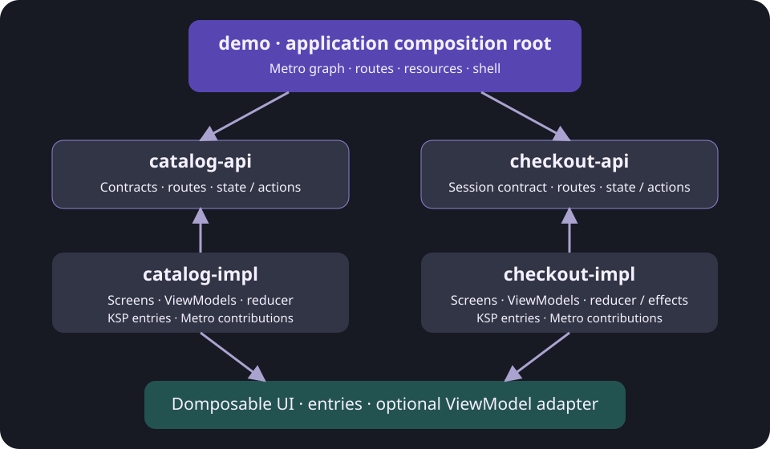

# A modular app with MVI, ViewModel and Metro

Fieldwork now has **two feature teams**, catalog and checkout. Each owns an API module and an implementation module. The demo application assembles them with Metro, while Domposable's optional KSP processor generates typed destinations and feature entry lists. Android, iOS, desktop, semantic HTML and Wasm run the same feature implementations.



## Module responsibilities

| Gradle module | Source directory | Owns |
| --- | --- | --- |
| `:catalog-api` | `feature/catalog/api` | Product contracts, catalog routes, immutable state/actions and the feature entry interface |
| `:catalog-impl` | `feature/catalog/impl` | Catalog repository, reducers, ViewModels, screens, Metro contributions and generated entries |
| `:checkout-api` | `feature/checkout/api` | Cart/checkout routes, state/actions, session contract and feature entry interface |
| `:checkout-impl` | `feature/checkout/impl` | Cart reducer, session implementation, entry ViewModels, checkout effects and screens |
| `:demo` | `demo` | Application graph, theme, artwork, shell, URL codec and navigator |

The API modules depend on the UI, screen and optional navigation contracts. They have **no Metro dependency or ViewModel base class**. Catalog implementation consumes the checkout API to add products; checkout implementation consumes the catalog API for product data. Implementation modules never depend on each other or on the application.

Gradle uses distinct names such as `catalog-api` and `checkout-api` even though their directories end in `api`. This prevents artifact capability and Kotlin module identity collisions. These are application sample modules; they are not part of Domposable's Maven publication.

## 1. Define a feature API

Expose the feature's entry list and ordinary values/actions. The storefront chooses the optional navigator:

```kotlin
interface CatalogFeature {
    fun entries(
        navigator: DomposableNavigator<ShopRoute>,
        artwork: ShopArtwork,
        onArtworkLoaded: (() -> Unit)? = null,
    ): List<DomposableDestination<*>>
}

sealed interface CatalogAction {
    data class Search(val value: String) : CatalogAction
    data class Category(val value: String) : CatalogAction
    data class Sort(val ascending: Boolean) : CatalogAction
    data class Add(val id: String) : CatalogAction
    data object ClearFilters : CatalogAction
}
```

`ShopArtwork` is a composable function supplied by the application. The features request a filename, accessible description, size and image scale; only the app knows its Compose resource bundle. Entry wrappers receive the sample navigator and navigate using route API types. Their UI composables still receive callbacks. A feature choosing another router can expose callbacks instead; the library does not require this sample interface.

## 2. Implement MVI behind the API

Catalog ViewModels expose immutable state through `StateFlow`; user actions pass through the feature reducer. Adding a product delegates to the shared cart contract:

```kotlin
@Inject
class CatalogViewModel(
    val catalog: ProductCatalog,
    val cart: ShoppingCart,
) : ViewModel() {
    private val mutableState = MutableStateFlow(CatalogState(catalog.products))
    val state: StateFlow<CatalogState> = mutableState.asStateFlow()

    fun dispatch(action: CatalogAction) {
        when (action) {
            is CatalogAction.Add -> cart.dispatch(CheckoutAction.Add(action.id))
            else -> mutableState.update { reduceCatalog(it, action) }
        }
    }
}
```

The cart reducer uses integer cents, rejects unknown product IDs, caps each quantity at 20, calculates delivery, validates checkout and clears personal details after a successful demo order. `CheckoutViewModel` exposes `CheckoutEffect.OrderPlaced` separately from persistent state. Its destination collects that one-off effect and replaces the checkout entry with confirmation, so Back returns to the bag. Invalid submissions update validation state without navigating.

This MVI protocol belongs to the **sample application**. A Domposable screen still accepts normal values and callbacks. The task playground and small published-consumer examples continue to show plain Compose state.

## 3. Declare entries with KSP

Apply the Domposable processor to each implementation module's common metadata. Annotate the entry wrapper:

```kotlin
@Composable
@DomposableScreen(route = CatalogRoute.Collection::class, viewModel = true)
internal fun Collection(
    newCatalog: () -> CatalogViewModel,
    navigator: DomposableNavigator<ShopRoute>,
    artwork: ShopArtwork,
) {
    val model = viewModel { newCatalog() }
    val state by model.state.collectAsState()
    val cart by model.cart.state.collectAsState()
    CollectionScreen(
        state.copy(notice = cart.notice), model::dispatch, artwork,
        { navigator.navigate(CatalogRoute.Collection) },
        { navigator.navigate(CatalogRoute.Product(it)) },
    )
}
```

KSP generates `collectionEntry(newCatalog, navigator, artwork)`, installs the entry's optional ViewModel owner and supplies route parameters when present. It also generates `domposableEntries(...)` containing every annotated entry in that package. The Metro feature implementation supplies its dependencies once:

```kotlin
override fun entries(
    navigator: DomposableNavigator<ShopRoute>,
    artwork: ShopArtwork,
    onArtworkLoaded: (() -> Unit)?,
) = domposableEntries(
    newCatalog = newCatalog,
    newProduct = newProduct,
    navigator = navigator,
    artwork = artwork,
    onArtworkLoaded = onArtworkLoaded,
)
```

The app combines both feature lists; there is no application registry:

```kotlin
val navigator = rememberDomposableNavigator<ShopRoute>(CatalogRoute.Home, ShopCodec, browserUrls)
val entries = remember(graph, navigator, artwork) {
    graph.catalog.entries(navigator, artwork) + graph.checkout.entries(navigator, artwork)
}
DomposableNavHost(navigator, entries)
```

`newCatalog` is an injected `() -> CatalogViewModel`. The ViewModel store belongs to its entry, so recomposition reuses the model and removing the entry clears it. Discover and Collection have different ViewModels and preserve their filters when returning to an existing entry. They share the shopping session. Product gets its route ID automatically and passes it to Metro's assisted factory.

KSP does not infer MVI or DI. Without KSP, declare `DomposableDestination` or register route types directly. Without the navigator, keep your own stack. [Direct Navigation 3 and manual registry examples](screens.md) show both alternatives.

## 4. Aggregate Metro contributions in the app

Implementation modules contribute bindings under the sample's `ShopScope` marker:

```kotlin
@Inject
@SingleIn(ShopScope::class)
@ContributesBinding(ShopScope::class)
class InMemoryShoppingCart(catalog: ProductCatalog) : ShoppingCart

@Inject
@ContributesBinding(ShopScope::class)
class DefaultCatalogFeature(
    private val newCatalog: () -> CatalogViewModel,
    private val newProduct: ProductViewModel.Factory,
) : CatalogFeature
```

The product ViewModel uses `@AssistedInject` and an `@AssistedFactory` to receive the current route's product ID. The app graph exposes feature API types:

```kotlin
@DependencyGraph(ShopScope::class)
abstract class ShopGraph {
    abstract val catalog: CatalogFeature
    abstract val checkout: CheckoutFeature
    abstract val cart: ShoppingCart
    abstract val products: ProductCatalog
}

fun createShopGraph(): ShopGraph = createGraph<ShopGraph>()
```

Apply the Metro compiler plugin to the implementation and graph modules. The application depends on the API modules for source contracts and includes implementation modules for Metro's cross-module aggregation. Create one graph per shopping flow; scope repositories and the cart to that graph, while ViewModel factories remain unscoped.

The graph and cart are an in-memory demo session. Resize and navigation preserve them; a new flow or full reload creates a fresh session. The sample does not implement process-death restoration, durable orders or browser persistence. An application needing those can persist through its repository and restore drafts using the entry's saved-state owner.

## Build and verify

```bash
./gradlew :catalog-impl:jvmTest :checkout-impl:jvmTest :demo:jvmTest
./gradlew :androidApp:assembleDebug :demo:jsBrowserDevelopmentWebpack :demo:wasmJsBrowserDevelopmentWebpack
./gradlew :demo:linkDebugFrameworkIosSimulatorArm64
```

CI compiles these modules through every demo target, checks reducer behavior and session independence, and runs the same browser checkout and reviewed platform screenshots. Because KSP-generated factories and aggregated lists are used by feature implementations, compilation also verifies their generated names and route types.

[Browse the feature modules](https://github.com/samuolis/domposable/tree/main/feature) · [Metro aggregation](https://zacsweers.github.io/metro/latest/aggregation/) · [Optional library integrations](integrations.md)
