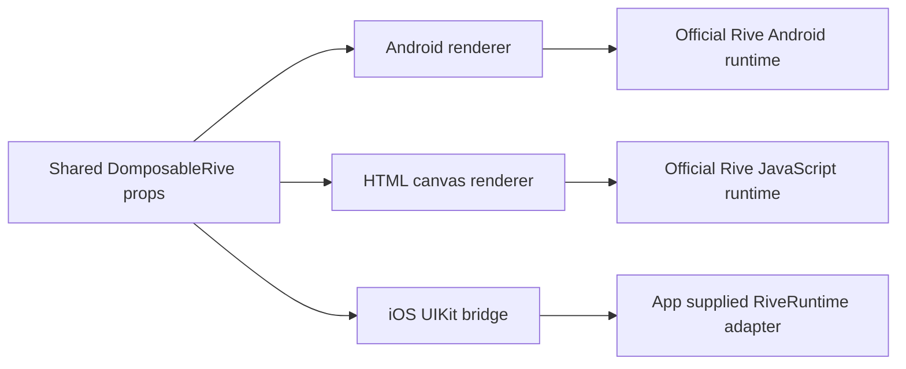

# Rive animations

The optional `domposable-rive` artifact renders local `.riv` bytes with Rive's native Android runtime and web JavaScript runtime. Its shared props select a named artboard and either a linear animation or state machine. Increment `playbackKey` to replay a named animation after an event. Set `autoplay = false` when motion should stay on its authored first frame.

```kotlin
@Composable
fun WinAvatar(outfit: Outfit, winCount: Long, reducedMotion: Boolean) {
    val winAnimation by produceState<ByteArray?>(null, outfit.id) {
        value = runCatching { Res.readBytes("files/${outfit.assetName}.riv") }.getOrNull()
    }

    Box {
        AvatarPortrait(outfit.portrait)
        winAnimation?.let { bytes ->
            DomposableRive(
                props = DomposableRiveProps(
                    file = bytes,
                    artboardName = outfit.artboardName,
                    animationName = "win",
                    autoplay = !reducedMotion,
                    playbackKey = winCount,
                    contentDescription = "Winner avatar",
                ),
                modifier = Modifier.fillMaxSize(),
            )
        }
    }
}
```

`Res.readBytes` is suspend, so the sample loads it through `produceState` and keeps the portrait visible until the local asset is ready. Supply `fallback` when you want a platform renderer to keep alternate content behind the animation surface. Rive itself does not provide an error callback through this shared API, so runtime parsing failures are owned by the platform renderer.

## Architecture at a glance

- `domposable-rive` is a separate opt-in artifact; applications that do not depend on it do not receive a Rive runtime dependency.
- Android embeds the official Rive Android view in Compose and reads the file from bytes.
- HTML renders the official Rive JavaScript runtime into a semantic canvas host; no WebView is involved.
- iOS keeps the official Swift runtime in the app's Xcode dependency graph. The app registers a small UIKit adapter, so consumers that do not use Rive on iOS have no Swift package dependency.



## iOS app bridge

Add Rive's `RiveRuntime` Swift package to the iOS app, implement the exported renderer interface, then register it before Compose content is created. The Kotlin API takes its file bytes as `KotlinByteArray`:

Use the official `RiveRuntime` product from Rive iOS 6.30.1 (commit `504153fc55c848c01bab2c40499c62834e6714d0`).

```swift
import RiveRuntime
import UIKit
import DomposableRive

final class AppRiveRenderer: NSObject, DomposableRiveIosRenderer {
    private var models: [ObjectIdentifier: RiveViewModel] = [:]
    private var playbackKeys: [ObjectIdentifier: Int64] = [:]
    private var autoplayValues: [ObjectIdentifier: Bool] = [:]

    func createView(props: DomposableRiveProps) -> UIView {
        let bytes = props.file
        let data = Data((0..<Int(bytes.size)).map { index in
            UInt8(bitPattern: bytes.get(index: Int32(index)))
        })
        guard let file = try? RiveFile(data: data, loadCdn: false) else {
            return transparentFallback(props.contentDescription)
        }
        let model = RiveModel(riveFile: file)
        let viewModel: RiveViewModel
        if let stateMachineName = props.stateMachineName {
            viewModel = RiveViewModel(model, stateMachineName: stateMachineName,
                                      autoPlay: props.autoplay, artboardName: props.artboardName)
        } else {
            viewModel = RiveViewModel(model, animationName: props.animationName,
                                      autoPlay: props.autoplay, artboardName: props.artboardName)
        }
        let view = viewModel.createRiveView()
        let id = ObjectIdentifier(view)
        models[id] = viewModel
        playbackKeys[id] = props.playbackKey
        autoplayValues[id] = props.autoplay
        return view
    }

    func updateView(view: UIView, props: DomposableRiveProps) {
        let id = ObjectIdentifier(view)
        guard let model = models[id] else { return }
        if !props.autoplay, autoplayValues[id] == true {
            model.pause()
        } else if props.autoplay,
                  autoplayValues[id] != true || playbackKeys[id] != props.playbackKey {
            model.play(animationName: props.animationName)
        }
        playbackKeys[id] = props.playbackKey
        autoplayValues[id] = props.autoplay
    }

    func disposeView(view: UIView) {
        let id = ObjectIdentifier(view)
        models.removeValue(forKey: id)?.deregisterView()
        playbackKeys.removeValue(forKey: id)
        autoplayValues.removeValue(forKey: id)
    }

    private func transparentFallback(_ label: String?) -> UIView {
        let view = UIView()
        view.isOpaque = false
        view.backgroundColor = .clear
        view.accessibilityLabel = label
        return view
    }
}

DomposableRiveIosRuntime.shared.renderer = AppRiveRenderer()
```

The bridge uses Rive's UIKit `RiveViewModel` API so it can supply an ordinary `UIView` to Compose Multiplatform. Rive's legacy UIKit model API is deprecated in favor of its newer concurrency API; keep this adapter at the app boundary and migrate it when a UIKit view API is available for the installed Rive package. The iOS no-registration fallback is a transparent, accessible `UIView`, so an app can keep its portrait visible beneath it.
